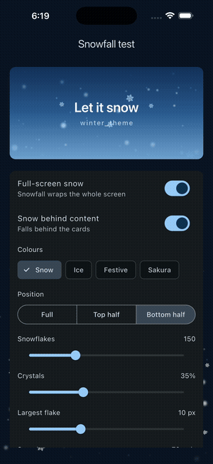
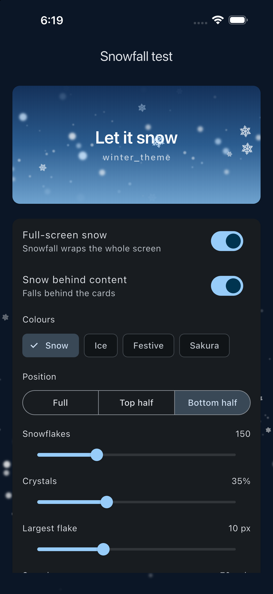
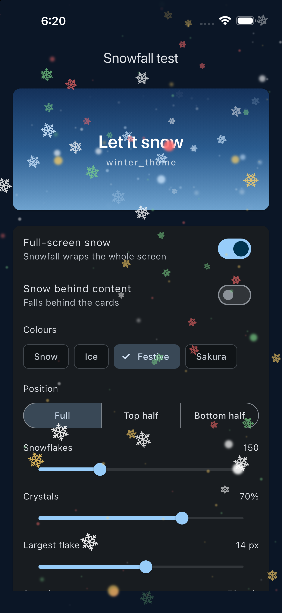
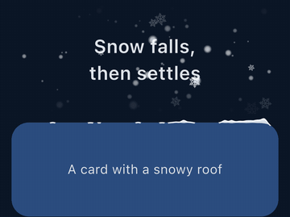
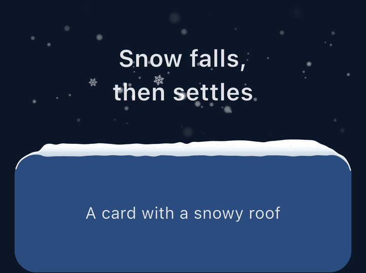
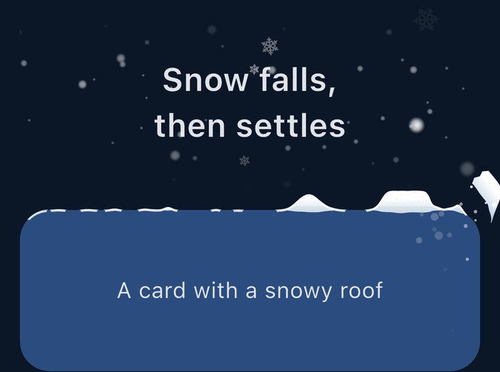

# winter_theme

A fully customizable snowfall effect for Flutter. Wrap any widget in
`Snowfall` and it snows inside that widget's box: a whole screen, a single
card, an app bar, or the entire app. Taps pass straight through the snow.

<p>
  
  
  
</p>

<p>
  
  
  
</p>

The package has two widgets: `Snowfall` (snow falling over a widget) and
`SnowCap` (snow settling on a widget's top edge).

## Features

- Six-armed ice crystals that spin as they fall, mixed with soft round flakes
- Steady wind plus gusts that roll through the snow in waves
- Flakes fade in at the top and out at the bottom instead of popping
- Custom colors, color palettes, and your own flake outline
- Snow in front of or behind your content
- Snow over any region: padding, alignment, and width and height factors
- Built for low-end devices: one ticker, no per-frame rebuilds, and every flake drawn from a cached sprite in a single draw call
- `SnowCap`: snow that builds up on a widget's top edge, drapes over rounded corners and breaks off at the corners
- No dependencies beyond Flutter

## Install

```yaml
dependencies:
  winter_theme: ^1.1.0
```

## Usage

```dart
import 'package:winter_theme/winter_theme.dart';

// Over one screen, card, app bar, or any other widget:
Snowfall(child: MyScreen())

// Over the whole app:
MaterialApp(
  builder: (context, child) => Snowfall(child: child!),
  home: const HomeScreen(),
)
```

### Colors

```dart
Snowfall(
  colors: const [Colors.white, Color(0xFFBFE3FF), Color(0xFF8FC7FF)],
  child: child,
)
```

### Position

```dart
// Only in the top third, and behind the content:
Snowfall(
  layer: SnowfallLayer.background,
  alignment: Alignment.topCenter,
  heightFactor: 1 / 3,
  child: child,
)
```

With `SnowfallLayer.background` the snow shows only through the transparent
parts of the child, so give the child a transparent background.

### Motion

```dart
Snowfall(
  numberOfSnowflakes: 250,
  minSpeed: 60,
  maxSpeed: 180,
  wind: 40, // steady drift to the right
  gustiness: 120, // strong gusts
  child: child,
)
```

### Custom shapes

Draw your own outline for a flake of radius 1 centered on the origin. It is
scaled, rotated and stroked for each flake.

```dart
Snowfall(
  crystalFraction: 1,
  crystalPath: Path()
    ..moveTo(0, -1)
    ..lineTo(0.6, 0.8)
    ..lineTo(-0.95, -0.3)
    ..lineTo(0.95, -0.3)
    ..lineTo(-0.6, 0.8)
    ..close(), // a star
  child: child,
)
```

## SnowCap

`SnowCap` draws snow that settles on the top edge of its child, the way real
snow does. The edge starts bare. Random patches form and join into one heap
over `settleTime`. Once the corners fill up, pieces break off, tip over and
fall down the sides, and the broken spots fill in again.

```dart
SnowCap(
  borderRadius: BorderRadius.circular(16),
  child: Card(child: MyContent()),
)
```

It never takes pointer events, and the child lays out exactly as it would
without `SnowCap`. Set `seed` to make the heap, the flakes and the breaks
repeat exactly (useful in golden tests).

### Clipping

The snow is drawn above and beside the child, so **a clipping ancestor cuts
it off**: a `ClipRRect`, a `Card` with a clip, or the edge of a scrolling
viewport. Wrap the outermost widget that shares the top edge, and leave room
above it.

### Screens that rebuild often

A new `SnowCap` starts bare. If a screen is rebuilt or re-created often, or in
golden tests, set `startSettled: true` so the heap is full on the first frame.
Changing parameters on a live `SnowCap` keeps its heap, and a width change
(rotation, resize) resamples it instead of resetting.

### Snowfall + SnowCap

Snow falls over a header, then settles on the card below it:

```dart
Column(
  children: [
    SizedBox(
      height: 150,
      child: Snowfall(child: Center(child: Text('Snow falls, then settles'))),
    ),
    SnowCap(
      borderRadius: BorderRadius.circular(24),
      child: Card(child: MyContent()),
    ),
  ],
)
```

### Customization

```dart
SnowCap(
  // Fill the snow with an image. Any ImageProvider works; NetworkImage is
  // cached by Flutter's image cache.
  texture: const NetworkImage('https://example.com/snow.png'),
  // Draw your own decoration under or over the snow. The origin is the
  // child's top-left corner, so you can draw above the edge.
  backgroundPainter: MyIciclePainter(),
  foregroundPainter: MySparklePainter(),
  // Any widget over the child, for example a Lottie animation.
  overlay: Align(
    alignment: Alignment.topCenter,
    child: FractionalTranslation(
      translation: const Offset(0, -0.8),
      child: Lottie.asset('assets/sparkle.json', width: 80),
    ),
  ),
  child: card,
)
```

`winter_theme` depends only on Flutter. To use Lottie, add the `lottie`
package to your own app.

### SnowCap options

| Parameter | Default | Meaning |
| --- | --- | --- |
| `enabled` | `true` | Off renders only the child and schedules no frames. |
| `thickness` | `12` | Height of the full heap above the edge. |
| `overlap` | `2` | How far the snow lips over the front edge. |
| `borderRadius` | zero | Corner radii of the child; only the top corners are used. |
| `settleTime` | 30 s | Time for a bare edge to build up into one heap. |
| `startSettled` | `false` | Start as a full heap and skip the build-up. |
| `accumulating` | `true` | `false`: no new flakes land, the heap stays as it is. |
| `shedding` | `true` | `false`: the corners never break off. |
| `chunkSize` | `24` | Typical length of a broken piece. |
| `shedRate` | `1.0` | Multiplier on how often breaks happen. |
| `fallSpeed` | `1.0` | Multiplier on tipping and falling speed. |
| `fallDistance` | `null` | How far pieces fall; null is the child's full height. |
| `color` | white | Colour of the top surface. |
| `shadeColor` | `0xFFD5E2EE` | Tone of the base and underside. |
| `seed` | `null` | Fixes the heap, flakes and breaks for tests and screenshots. |
| `texture` | `null` | Image that fills the snow instead of the gradient. |
| `backgroundPainter` | `null` | Custom painter between the child and the snow. |
| `foregroundPainter` | `null` | Custom painter over the snow. |
| `overlay` | `null` | Widget over the child and the snow. |

The animation uses one ticker. It runs only while `enabled` and `accumulating`
or `shedding` is on (or pieces are still falling), pauses with `TickerMode`
(offscreen, inactive tabs, route transitions), and is replaced by a still,
fully settled heap when the system asks for reduced motion.

## Snowfall options

| Parameter | Default | Meaning |
| --- | --- | --- |
| `enabled` | `true` | Turns the snow on or off. Off schedules no frames. |
| `numberOfSnowflakes` | `120` | Flakes on screen at once. |
| `color` | white | Color of every flake. Ignored when `colors` is set. |
| `colors` | `null` | Palette each flake picks its color from at random. |
| `shape` | `crystal` | `SnowflakeShape.crystal` mixes ice crystals with round flakes; `dot` draws only round flakes. |
| `crystalFraction` | `0.35` | Share of the larger flakes drawn as crystals. |
| `crystalPath` | `null` | Custom outline drawn instead of the built-in crystal. |
| `minSize` / `maxSize` | `1.5` / `10` | Flake radius range in logical pixels. |
| `minSpeed` / `maxSpeed` | `30` / `90` | Fall speed range in pixels per second. |
| `wind` | `0` | Steady horizontal drift in pixels per second; negative blows left. |
| `gustiness` | `45` | Strength of the gusts in pixels per second; `0` is still air. |
| `sway` | `1` | Multiplier for the side-to-side swing; `0` falls straight. |
| `spin` | `1` | Multiplier for crystal rotation; `0` stops it. |
| `opacity` | `0.9` | Opacity of the nearest flakes. |
| `fadeExtent` | `56` | Height of the top and bottom bands where flakes fade in and out; `0` gives hard edges. |
| `layer` | `foreground` | `SnowfallLayer.foreground` or `background`. |
| `padding` | zero | Insets the snowing area from the child's edges. |
| `alignment` | center | Where the snowing area sits when it is smaller than the child. |
| `widthFactor` / `heightFactor` | `1` / `1` | Size of the snowing area as a fraction of the child. |
| `seed` | `null` | Fixes the random layout, for golden tests and screenshots. |

## Example

The app in [`example/`](example) is a playground with live controls for
the `Snowfall` options. As you change them it shows the matching `Snowfall(...)` code
with a copy button, so you can tune the snow by eye and paste the result into
your app. The tune button in its app bar hides the controls.

The snowflake button in its app bar opens a `SnowCap` demo: snow falls over a
header and settles on a card, with toggles for `startSettled`, `accumulating`
and `shedding`.

The controls exist only in the example. The package itself draws nothing but
snow, so your users never see them.

## License

Apache 2.0. See [LICENSE](LICENSE).
